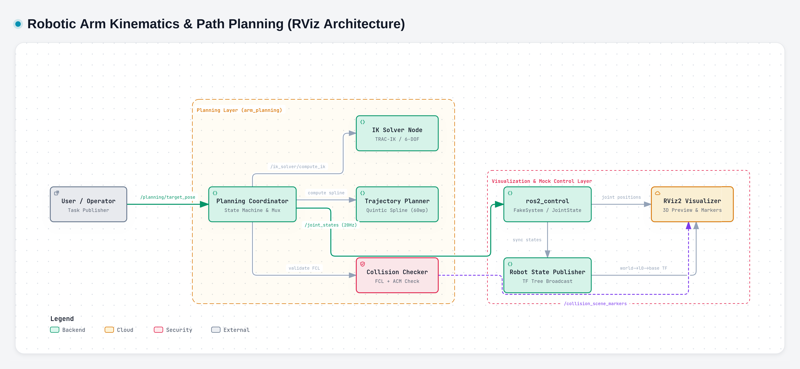

# DecodeLabs Project 1: Robotic Arm Kinematics & Path Planning

Aku bikin "otak digital" buat lengan robot UR5e 6-DOF di ROS 2. Intinya: kirim titik tujuan dalam ruang (x, y, z + orientasi), robot otomatis hitung tekukan sendinya, bikin jalur gerakan yang halus, cek dulu aman atau nabrak, baru digerakkan di RViz. Gazebo sengaja tidak dipakai biar enteng — cukup RViz + FakeSystem aja.



*Diagram interaktif: [docs/architecture.html](docs/architecture.html)*

---

## Daftar Isi
1. [Fitur Utama](#fitur-utama)
2. [Tech Stack](#tech-stack)
3. [Apa yang Terjadi di Balik Layar (IPO)](#apa-yang-terjadi-di-balik-layar-ipo)
4. [Persamaan Matematis & Perhitungan](#persamaan-matematis--perhitungan)
5. [Tata Letak File](#tata-letak-file)
6. [Tiap Folder & Node Ngapain](#tiap-folder--node-ngapain)
7. [Jalur Komunikasi ROS 2](#jalur-komunikasi-ros-2)
8. [Cara Install & Build](#cara-install--build)
9. [Cara Menjalankan](#cara-menjalankan)
10. [Tes Tanpa Buka RViz](#tes-tanpa-buka-rviz)
11. [Aturan Keselamatan](#aturan-keselamatan)
12. [Kalau Ada Kendala](#kalau-ada-kendala)
13. [Author](#author)

---

## Fitur Utama

- **Model robot asli — UR5e 6-DOF.** Bukan rakitan silinder sembarangan, tapi mesh dan parameter resmi dari `ur_description` v0.14, plus meja, kubus merah, dan silinder biru di atasnya.
- **Otaknya pinter: TRAC-IK.** Cukup kasih posisi tujuan, node `ik_solver` langsung kasih tahu harus nekuk sendi berapa derajat. Ada cek batas juga biar sendi nggak dipaksa lewat nurani robot.
- **Geraknya nggak kaku.** Pakai polinomial quintic — jadi jalan, kecepatan, sampai akselerasinya nyambung. Nggak menghentak.
- **Takut nabrak? Aman.** Tiap langkah dijalur dicek sama FCL (Flexible Collision Library). Kalau bakal nyenggol meja atau balok, jalannya ditolak biar nggak terjadi kecelakaan.
- **Ada manajernya.** Satu node (`planning_coordinator`) atur alurnya: dapat target → cek transform → hitung IK → bikin jalur → cek tabrakan → jalan. Kalau ada tombol darurat ditekan, semua langsung dikunci.

---

## Tech Stack

| Komponen | Pakainya | Buat apa |
|---|---|---|
| **Middleware** | ROS 2 Humble | Ngobrol antar node |
| **Robot** | UR5e Universal Robots | Lengan 6 sendi |
| **Model fisik** | URDF/Xacro | Rangka, mesh visual/collision |
| **Visual** | RViz2 | Lihat robot gerak + preview jalur |
| **Kontrol** | `ros2_control` FakeSystem | Simulasi tanpa hardware asli |
| **Cek tabrakan** | `python-fcl` | Cek tiap titik bakal nabrak nggak |
| **Bahasa** | Python 3.10+ (`rclpy`) | Node planning |

> Kenapa nggak pakai Gazebo? Awalnya pakai, tapi berat dan sering crash di Linux headless. Buat nguji kinematika, trajectory, sama collision, RViz-only sudah cukup dan jauh lebih ringan.

---

## Apa yang Terjadi di Balik Layar (IPO)

Bayangin alurnya kayak gini:

**Input** — Kamu kirim pesan `PoseStamped` ke topik `/planning/target_pose`. Isinya: koordinat `x, y, z` (meter) + orientasi `qx, qy, qz, qw` (quaternion), frame-nya `base_link`.

**Process** — Sistem kerja berurutan:
1. Cek transform `base_link` masih fresh (umur ≤1 detik).
2. Hitung IK pakai TRAC-IK (coba sampai 3 kali, timeout 50ms).
3. Bikin trajectory quintic minimal 60 titik, durasi otomatis (batas kecepatan `π rad/s`).
4. Cek tabrakan multi-link untuk setiap titik pakai FCL.

**Output** — Kalau lolos, kirim `JointTrajectory` ke `/planning/trajectory_preview` buat ditampilin di RViz, plus marker rintangan di `/collision_scene_markers`. Kalau gagal, kasih tau kenapa: `IK_NO_SOLUTION`, `COLLISION_DETECTED`, atau `OUT_OF_WORKSPACE`.

---

## Persamaan Matematis & Perhitungan

Bagian ini buat yang penasaran rumusnya — bisa skip kalau cuma mau jalanin robot.

### 1. Validasi Quaternion

Quaternion harus ternormalisasi supaya rotasi valid:

$$\sqrt{q_x^2 + q_y^2 + q_z^2 + q_w^2} = 1 \pm 0.001$$

Kalau nilainya melenceng, solver nolak targetnya.

### 2. Batas Workspace Robot

UR5e cuma bisa jangkau area silinder. Cek dulu sebelum dihitung:

$$R = \sqrt{x^2 + y^2} \le 0.85\ \text{m} \qquad |z| \le 1.2\ \text{m}$$

Lewat dari situ → `OUT_OF_WORKSPACE`.

### 3. Forward Kinematics (DH Parameters UR5e)

Tiap sendi punya matriks transform Denavit-Hartenberg:

$$^{i-1}T_i = \begin{bmatrix} \cos\theta_i & -\sin\theta_i\cos\alpha_i & \sin\theta_i\sin\alpha_i & a_i\cos\theta_i \\ \sin\theta_i & \cos\theta_i\cos\alpha_i & -\cos\theta_i\sin\alpha_i & a_i\sin\theta_i \\ 0 & \sin\alpha_i & \cos\alpha_i & d_i \\ 0 & 0 & 0 & 1 \end{bmatrix}$$

Kalikan semua dari base sampai tool:

$$^0T_6 = \,^{0}T_1 \,^{1}T_2 \,^{2}T_3 \,^{3}T_4 \,^{4}T_5 \,^{5}T_6$$

Dari matriks ini kita ambil posisi `p = (x, y, z)` dan rotasi `R` buat collision check.

Parameter DH-nya (UR5e):

| Link | $d$ (m) | $a$ (m) | $\alpha$ (rad) |
|---|---|---|---|
| 1 | 0.1625 | 0.0 | $\pi/2$ |
| 2 | 0.0 | -0.425 | 0 |
| 3 | 0.0 | -0.3922 | 0 |
| 4 | 0.1333 | 0.0 | $\pi/2$ |
| 5 | 0.0997 | 0.0 | $-\pi/2$ |
| 6 | 0.0996 | 0.0 | 0 |

### 4. Inverse Kinematics (Fallback Geometri)

Kalau TRAC-IK Python belum ada, pakai fallback analitik 2-link di bidang radial:

$$\theta_1 = \operatorname{atan2}(y, x)$$

$$D = \sqrt{r_{xy}^2 + \Delta z^2}, \quad r_{xy}=\sqrt{x^2+y^2}, \quad \Delta z = z - d_1$$

$$\cos\theta_3 = \frac{D^2 - a_2^2 - a_3^2}{2 a_2 a_3} \quad\Rightarrow\quad \theta_3 = \arccos(\cos\theta_3)$$

$$\alpha = \operatorname{atan2}(\Delta z, r_{xy}), \quad \beta = \operatorname{atan2}(a_3\sin\theta_3,\ a_2 + a_3\cos\theta_3)$$

$$\theta_2 = -(\alpha + \beta), \quad \theta_4 = -(\theta_2 + \theta_3), \quad \theta_5 = -\pi/2, \quad \theta_6 = 0$$

### 5. Trajectory — Quintic Polynomial Spline

Biar geraknya halus (posisi, kecepatan, akselerasi kontinyu):

$$\alpha = \frac{t}{T}, \qquad s(\alpha) = 10\alpha^3 - 15\alpha^4 + 6\alpha^5$$

$$\dot{s}(t) = \frac{30\alpha^2 - 60\alpha^3 + 30\alpha^4}{T}$$

Posisi dan kecepatan sendi:

$$q_j(t) = q_{start,j} + s(\alpha)\,(q_{goal,j} - q_{start,j})$$

$$\dot{q}_j(t) = \dot{s}(t)\,(q_{goal,j} - q_{start,j}), \quad |\dot{q}_j| \le \pi\ \text{rad/s}$$

Durasi dan waypoint:

$$T = \max\left(3.0,\ 1.5 \cdot \max_j|q_{goal,j} - q_{start,j}|\right), \qquad N = 20 \cdot T \approx 60$$

### 6. Collision Checking (FCL)

Tiap link disampling jadi bola-bola kecil di sepanjang segmen:

$$p_{sample} = (1-\lambda)\,p_i + \lambda\,p_{i+1}, \quad \lambda \in [0,1], \quad r_i \in \{0.06, 0.05, 0.045, ...\}$$

Untuk tiap sample $C_{robot}$ dan tiap objek lingkungan $C_{env}$ (meja, kubus, silinder):

$$\text{collide}(C_{robot}, C_{env}) = \texttt{fcl.collide}(\text{Sphere}(r_i), \text{Box/Cylinder})$$

Allowed Collision Matrix (ACM): `base ↔ table` diizinkan (robot memang duduk di meja), link bersebelahan diizinkan. Sisanya → kalau 1 titik saja collides → `COLLISION_DETECTED` + indeks waypoint.

### 7. Kecepatan & Waktu

Time parameterization simpel:

$$T = \max\left(\frac{\max_j|\Delta q_j|}{\pi},\ 1.0\right) \quad \text{(lama)}$$

Sekarang dipakai $T = \max(3.0,\ 1.5\cdot\max|\Delta q|)$ biar gerak terlihat jelas di RViz dan interpolasi 20 Hz (3 detik × 20 = 60 titik).

---

## Tata Letak File

```
Robotic-Arm-Kinematics-Path-Planning/
├── src/
│   ├── arm_description/      # Bentuk robot & RViz
│   │   ├── launch/display.launch.py
│   │   ├── rviz/view_robot.rviz
│   │   └── urdf/{robot,ur5e,workspace_objects}.urdf.xacro
│   ├── arm_control/          # Config fake controller
│   │   └── config/controllers.yaml
│   ├── arm_planning/         # Otak robot
│   │   ├── arm_planning/{ik_solver,trajectory_planner,collision_checker,planning_coordinator}_node.py
│   │   ├── config/{kinematics,collision_objects}.yaml
│   │   └── launch/planning.launch.py
│   └── arm_bringup/          # Satu klik jalanin semua
│       └── launch/simulation.launch.py
├── test_pipeline_e2e.py      # Tes matematis tanpa GUI
├── docs/{architecture.png, architecture.html}
├── PRD.md / architecture.md / instructions.md / TODO.md
```

---

## Tiap Folder & Node Ngapain

- **arm_description** — Ngerakit file Xacro jadi robot utuh. `robot.urdf.xacro` nyambungin UR5e + meja + kubus + silinder dengan rantai `world → table → l0 → base_link`. `use_fake_hardware=true` biar nggak butuh Gazebo.
- **arm_control** — Isinya cuma `controllers.yaml` buat `JointTrajectoryController` palsu.
- **arm_planning** — Otaknya ada di sini semua: `ik_solver` (hitung sendi), `trajectory_planner` (bikin jalur), `collision_checker` (cek nabrak), `planning_coordinator` (atur urutan + jaga darurat).
- **arm_bringup** — `simulation.launch.py` buat nyalain RViz + semua node planning sekaligus.

---

## Jalur Komunikasi ROS 2

| Topik | Tipe | Dari | Ke | Buat apa |
|---|---|---|---|---|
| `/joint_states` | `sensor_msgs/JointState` | mock executor | RViz & planning | Posisi sendi sekarang |
| `/planning/target_pose` | `geometry_msgs/PoseStamped` | kamu | coordinator | Tujuan end-effector |
| `/planning/trajectory_preview` | `trajectory_msgs/JointTrajectory` | coordinator | RViz | Lihat jalur sebelum jalan |
| `/collision_scene_markers` | `visualization_msgs/MarkerArray` | collision_checker | RViz | Kotak/silinder merah |
| `/emergency_stop` | `std_msgs/Bool` | safety | coordinator | Tombol darurat |

| Service | Tipe | Server | Buat apa |
|---|---|---|---|
| `/ik_solver/compute_ik` | `moveit_msgs/GetPositionIK` | ik_solver | Hitung IK |
| `/planning/reset` | `std_srvs/Trigger` | coordinator | Buka kunci habis darurat |

| Action | Tipe | Server | Client |
|---|---|---|---|
| `/arm_controller/follow_joint_trajectory` | `control_msgs/FollowJointTrajectory` | FakeSystem | coordinator |

---

## Cara Install & Build

```bash
micromamba activate ros2_env  # atau source /opt/ros/humble/setup.bash
pip install python-fcl scipy numpy pyyaml
colcon build --symlink-install
source install/setup.bash
```

---

## Cara Menjalankan

**Terminal 1 — Buka simulasi (tunggu RViz muncul):**
```bash
./run_simulation.sh
# password kalau diminta: kali atau ricou
```

**Terminal 2 — Gerakin robot:**

*Maju (depan):*
```bash
podman exec $(podman ps -q) bash -c "source /opt/ros/humble/setup.bash && source install/setup.bash && ros2 topic pub --once /planning/target_pose geometry_msgs/msg/PoseStamped '{header: {frame_id: \"base_link\"}, pose: {position: {x: 0.55, y: 0.00, z: 0.35}, orientation: {w: 1.0}}}'"
```

*Mundur (belakang):*
```bash
podman exec $(podman ps -q) bash -c "source /opt/ros/humble/setup.bash && source install/setup.bash && ros2 topic pub --once /planning/target_pose geometry_msgs/msg/PoseStamped '{header: {frame_id: \"base_link\"}, pose: {position: {x: 0.25, y: 0.00, z: 0.35}, orientation: {w: 1.0}}}'"
```

*Darurat + buka kunci:*
```bash
ros2 topic pub --once /emergency_stop std_msgs/msg/Bool "{data: true}"
ros2 topic pub --once /emergency_stop std_msgs/msg/Bool "{data: false}"
ros2 service call /planning/reset std_srvs/srv/Trigger
```

---

## Tes Tanpa Buka RViz

Mau cek hitungannya bener tanpa buka jendela RViz?

```bash
micromamba run -p ~/ros2_env python3 test_pipeline_e2e.py
```

Kalau berhasil:

```
=== TEST PIPELINE KINEMATICS & PLANNING ===
 -> Pose valid & within workspace
 -> IK within limits
 -> Quintic: 60 waypoints over 3.00s, velocities ≤3.14 rad/s
 -> Loaded 3 obstacles
 -> Collision PASSED: 0 collisions
✅ PIPELINE INTEGRATION TEST: SUCCESSFUL
```

---

## Aturan Keselamatan

1. **Darurat (`LOCKED`):** `/emergency_stop=True` → goal langsung dibatalkan,状态 jadi `LOCKED`, semua target baru ditolak. Tetap terkunci walaupun `False` lagi — harus panggil `ros2 service call /planning/reset` baru buka.
2. **Batas kecepatan:** `≤π rad/s` tiap sendi. Kalau ada titik yang kecepatannya lewat, jalurnya ditolak mentah-mentah (bukan dibatasin paksa).
3. **Batas jangkauan:** Silinder `R>0.85m` atau `|Z|>1.2m` → ditolak `OUT_OF_WORKSPACE`.
4. **Tabrakan:** Nggak ada bypass. Kalau scene belum kebaca, semua jalur ditolak.

---

## Kalau Ada Kendala

- **Simulasi nggak jalan?** Pastikan Docker/podman jalan, lalu `chmod +x run_simulation.sh`.
- **`joint_state_publisher_gui` nggak ada?** `sudo apt install ros-humble-joint-state-publisher-gui`
- **`trac_ik_python` gagal import?** Wajar kalau `moveit_core` belum kebuild. Fallback geometri otomatis jalan. Mau TRAC-IK beneran: `colcon build --packages-up-to trac_ik_python`.

---

## Author

- **Rico Lazzami** ([@ricolazzami](https://github.com/ricolazzami))
- **Project:** DecodeLabs Internship Project 1
- **Lisensi:** Apache-2.0
